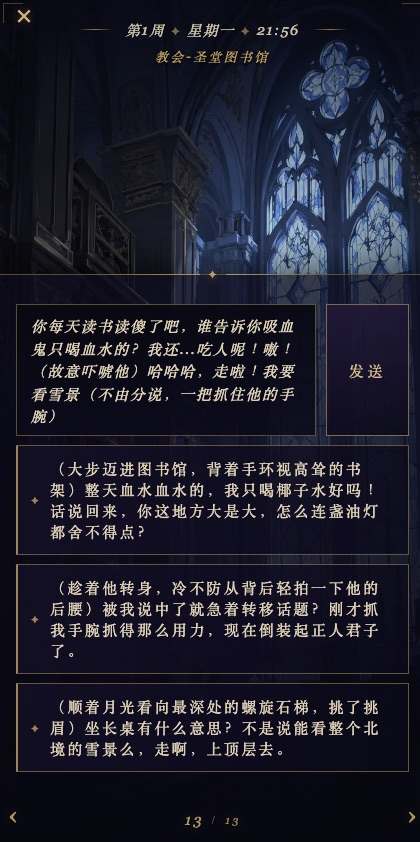
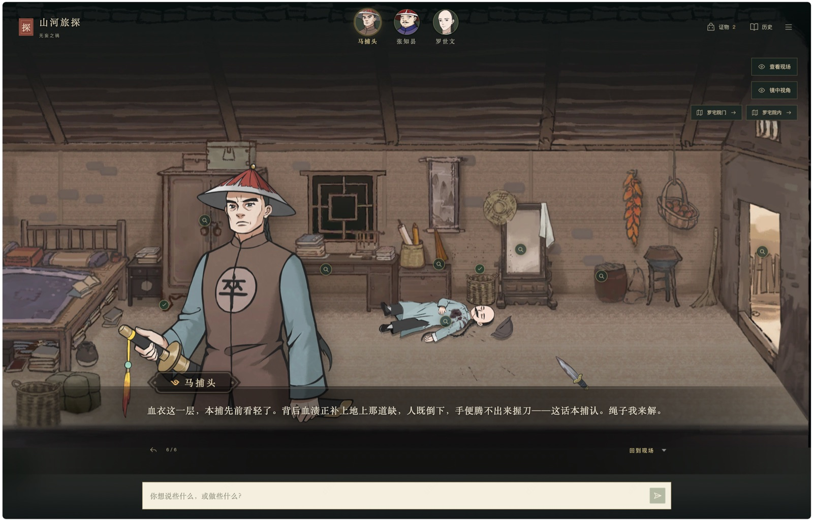
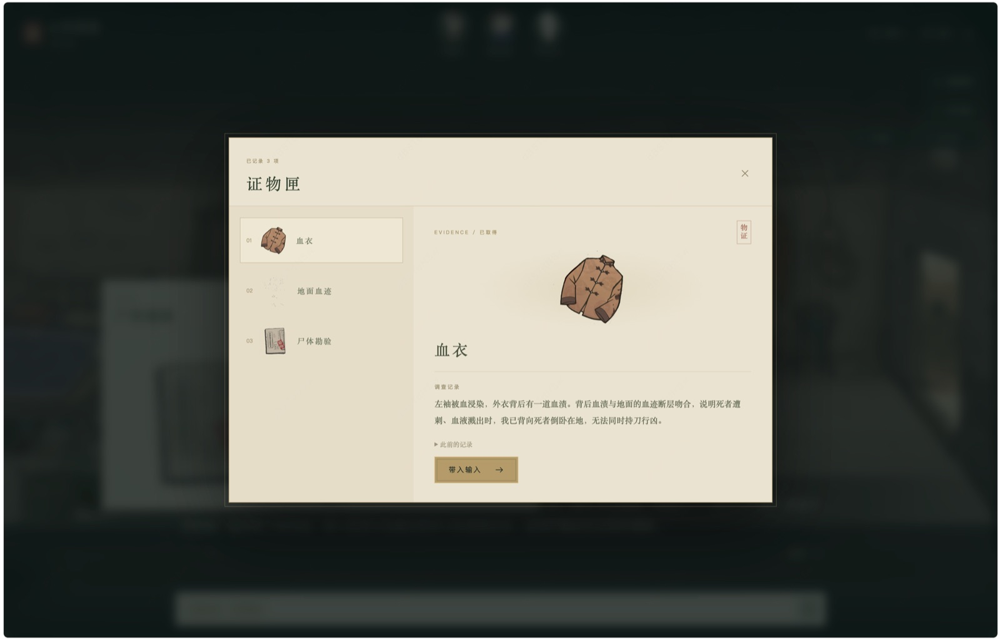
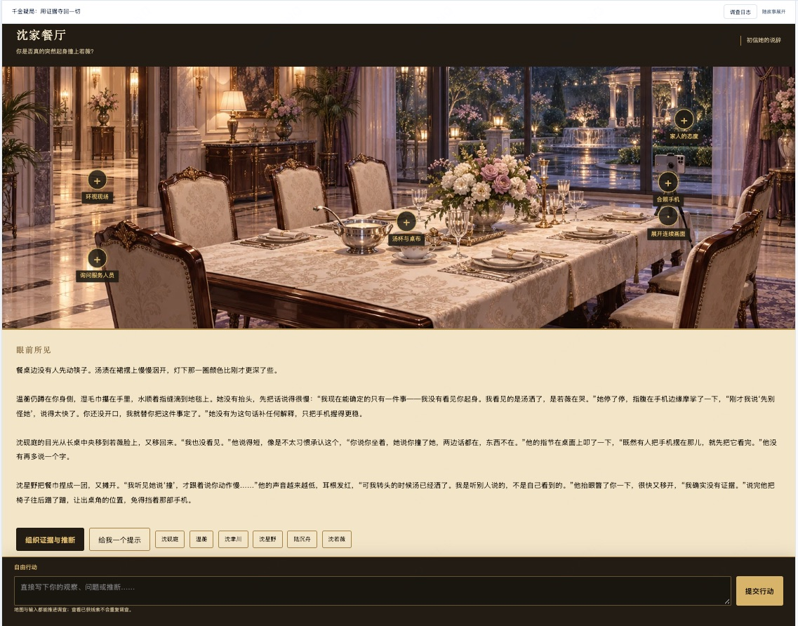
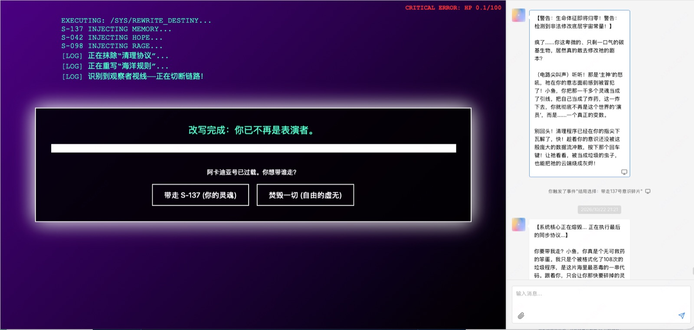

# On Interactive Fiction

---

## 一、背景

7 月我们做了两个 demo：偏恋爱陪伴的《油画老师》和偏剧情的《别墅第七号》。之后团队围绕这两个方向又做了不少尝试。最近一次集中讨论，大家倾向于把重心放在**文游**上——一种以互动解谜为核心、由 AI 驱动的文字冒险。

---

## 二、为什么是文游

**1. 我们自己的 demo 给了信号**

《别墅第七号》被改成文游之后，体验明显更好了。地下室那扇门开不开、今天开还是明天开、要不要先去套女主人的话……这些"当下要做的决定"本身就是玩法，玩家能感觉到自己的选择有分量。相比之下，恋爱向的内容我们试了不少，效果不太稳定。

**2. AI 补上了文游最贵的那一块**

传统文字冒险的分支要一条条手写，所以通常只能给两三个选项。有了 AI，"选项之外的行动"也能被接住：玩家可以问一个设计者没想到的问题，做一件剧本里没写过的事，故事依然能回应。这是只有 AI 才能做的玩法，而不只是在老品类上加一层 AI。

**3. 和团队的能力更匹配**

恋爱向内容很依赖细腻的情感写作；文游更依赖结构——真相怎么藏，线索怎么摆，节奏怎么控。后者和团队擅长的机制设计更接近。

**4. 赛道相对没那么拥挤**

情感陪伴类产品在国内外都已经很多了。AI 加互动解谜还比较早期，想象空间可能更大一些。

**5. 和之前的探索不冲突**

一个好的文游故事往往有多个结局。通关之后，玩家依然可以和故事里的角色继续聊下去。之前在陪伴方向上的积累（角色设定、记忆、长期对话）在这里还用得上。

---

## 三、看到的几种做法

**猫又 ·《凛约》**

平台型产品猫又上的一个作品，偏视觉小说：立绘、场景、时间地点，翻页式叙事。比较有意思的是它的选项：每个选项都是一整段带动作的台词，玩家可以直接改完再发。选项更像是"帮你起了个头"。

&nbsp;&nbsp;

**山河旅探（团队 demo）**

开场交代案情之后，玩家就进入了现场：点场景里的可疑之处收集证物，选择和捕头、知县或相关人对话，从对话里套出信息。收集到的证物可以"带入输入"，拿着证据去追问。在这里，调查就是对话本身。

**千金疑局（团队 demo）**

场景图上标着可以调查的地方，下方是"眼前所见"的叙述。关键的一步是"组织证据与推断"：玩家自己挑证据、写下推断，提交后再由在场的人核验；卡住时可以要一个提示。

**祖宗来电（团队 demo）**

左边是剧情主线的节点目录，顶部是当前节点和几个状态值。每一轮给三个选项，分成"动作 / 内心 / 对话"三类，也可以随时自由说。玩家自由发挥时，主线会"原地等你"，并有剧情指路提示怎么回到主线。

**海洋求生（团队 demo）**

画面风格完全不同：赛博终端式的界面、生命值、终局抉择。每个剧本都可以有自己的界面和画风。

---

## 四、目前在想的产品形态

综合这些尝试，目前大致是下面这个样子，还在验证中。

**一局一个完整故事**

20 到 40 分钟，有开场、有调查、有高潮、有多个结局，碎片时间也能完整玩完一局。时长的控制本身是一种设计选择：太短，玩家来不及入戏；太长，手机场景下容易被打断。目前 20–40 分钟是我们认为在移动端可以支撑一个完整情绪弧的最小单位。每个剧本都应该有清晰的"进入感"和"落幕感"，让玩家有"我玩完了一件事"的满足。

**玩家身份由剧本决定**

可以是"你自己"，也可以带着一个人设进入故事，比如侦探、继承人、新来的学生。身份不是装饰，它决定玩家能问什么问题、掌握哪些初始信息、被 NPC 如何对待。同一个故事，带着不同身份进去，看到的世界可能截然不同——这也是多周目的动力之一。

**开场之后，靠对话推进**

开场交代完背景，就把玩家放进场景里：和角色聊天、套话、追问，在对话中拿到线索。这是和传统文游最不一样的地方。传统文游的"推进"靠点击热点、触发事件；我们的"推进"是对话本身。玩家问一句"你昨晚真的在家吗"，NPC 的回应方式、犹豫的时间、反问的角度，都是信息。线索藏在语言里，而不是场景里的发光图标。

**三个选项，加上随时自由输入**

每一轮给三个建议选项，降低上手门槛；同时随时可以自己写。选项尽量写成带动作的一句话，像一份可以直接用的草稿。这两种输入方式并不是非此即彼的关系：选项帮玩家在陌生场景里找到落脚点，自由输入给有想法的玩家留出空间。实际测试里，新玩家大多先用选项，熟悉之后开始混用，少数玩家从头到尾自由输入——这个分布是健康的。

**自由发挥时，主线在原地等你**

玩家可以离开主线去闲逛、去试探，主线不会丢；需要时有提示把人引回来。这样既有自由度，故事也不会散掉。"主线在原地等你"说起来容易，实现上需要系统始终追踪玩家当前所处的叙事节点，以及哪些关键事件还没触发。当玩家跑偏超过一定阈值，提示会以剧情内的方式出现——比如某个 NPC 突然来找你，而不是弹出一个"你偏离主线了"的系统提示。

**规则和状态交给程序，演绎交给 AI**

线索、证物、进度和关键数值由程序记录和判定，AI 负责把场景、人物和对白演活。真相是固定的，不会被 AI 随口改掉。这个分工的底层逻辑是：AI 很擅长"说得像"，但不擅长"算得准"。一旦让 AI 同时负责叙事和逻辑判定，就很容易出现"你说你有钥匙，但实际上你没拿到"这类状态污染。把状态机交给程序，AI 只在确定的事实范围内发挥，是目前我们认为最稳的架构思路。

**推理让玩家自己来做**

到了关键节点，由玩家组织证据、给出推断，系统来核验。解开谜题的成就感是玩家自己的。这一点参考了桌游里的推理机制：好的推理游戏不会在玩家凑齐线索后自动公布答案，而是要求玩家主动"指控"。这个动作本身有仪式感，也让错误的指控产生代价。玩家在提交推断之前的那几秒钟——重新翻看线索、推敲逻辑——是我们最想保留的体验时刻。

**每个剧本有自己的画面**

场景图和界面风格都按故事来定：悬疑的、古风的、赛博的，各不相同。统一 UI 框架降低开发成本，但视觉语言跟着故事走。一个发生在 1930 年代上海的悬案，和一个发生在太空站的密室，玩家拿到手的第一感受就应该不一样。这也是留给每个剧本创作者发挥的空间。

**结局之后，角色还在**

通关后可以继续和角色聊，不同的结局会带出不同的关系。破案之后，你和那个你一直怀疑的人会是什么关系？如果你选择了帮他隐瞒真相，之后的对话又会怎么走？结局不是终点，而是一段新关系的起点。这也是之前陪伴方向积累最直接的复用场景。

**先从单人开始**

几个人一起"跑团"非常有意思，但也复杂得多，先把单人体验做好。多人模式的核心难题不只是技术上的同步，而是叙事上的：每个玩家的行动都会影响 NPC 状态和线索分布，如何保证没有人"被晾在一边"、没有人意外剧透，是需要专门设计的问题。单人先跑通之后，这些问题才值得认真投入。

**平台和自产剧本同时在试**

一部分同学在把已有的故事交给 AI，看能不能跑通；一部分同学在原创写作。两条线并行，是为了尽快找到"什么样的故事结构最适合这个玩法"的答案。改编已有故事的优势是结构现成，缺点是原著的节奏不一定适合互动；原创的自由度高，但从零开始的成本也更高。

---

## 五、一些挑战

**逻辑推理是最大的难点**

AI 能把故事讲起来，但解谜需要严密的逻辑：线索之间要自洽，真相不能前后矛盾，不能太早透底，也不能被玩家几句话带偏。一个典型的失控场景是：玩家反复追问同一个 NPC，AI 为了"配合对话"而不断补充细节，最终补出了一条原本不存在的线索，或者提前暴露了真相。目前的思路是把规则和状态尽量放在程序里，AI 只负责演绎，但这条路能走多远还需要更多验证。每个 NPC 知道什么、不知道什么、在什么情况下会说什么，都需要在剧本层面提前定义清楚，而不是交给 AI 临场发挥。

**自由输入的边界**

玩家可能会说"我直接把门砸开"。放得太宽，谜题就被绕过去了；收得太紧，又变回了选择题。中间需要一层判断：这个动作在当前情况下能不能成立，会带来什么后果。这个判断既要有游戏逻辑的合理性（门是什么材质、玩家角色有没有工具），也要有叙事上的圆滑（就算判定失败，也要给玩家一个"角色做了但没成功"的合理回应，而不是冷冰冰地说"不允许"）。这一层"仲裁"机制目前还在探索中，是产品体验的关键一环。

**节奏和卡关**

跑团好玩，很大一部分来自主持人对节奏的把控。AI 来主持时，玩家卡住了要给提示，但不能直接给答案；玩家跑偏了，要能自然地拉回来。难点在于判断"玩家是在探索还是真的卡住了"：有人绕圈子是因为享受漫游，有人是因为完全不知道下一步该做什么，系统需要能区分这两种状态。提示的力度也要分级——先给方向性的模糊提示，再给具体的行动建议，尽量不到最后不直接给答案。节奏的另一个维度是情绪：调查阶段不能一直维持同样的紧张感，需要有松弛的时刻、有反转，张弛之间的切换目前主要还是靠剧本设计，AI 能不能动态调节是一个开放问题。

**剧本怎么生产**

一个能玩的文游剧本，需要拆出真相、线索、人物动机和结局条件。无论是改编已有的故事还是原创，都要先整理成这样的结构，这一步目前还比较依赖人工。具体来说，需要定义：完整的真相（哪怕玩家不一定能全部发现）、每条线索在哪里、由谁持有、触发条件是什么、NPC 的知识边界（每个人知道什么、隐瞒什么、在什么压力下会松口）、以及结局的分支条件。这套结构目前没有标准化工具，全靠人工整理，是剧本生产最耗时的部分。如果将来开放给创作者，这套流程必须工具化，否则门槛会太高。

**成本**

每一轮都要生成叙事，有时还要生成画面，一局下来的模型成本不低，需要在体验和成本之间找平衡。一局 30 分钟的文游，假设玩家平均每轮交互 2–3 次来回、每次生成 200–400 字，加上偶尔的场景图生成，单局模型成本目前在一个对免费用户不友好的区间。可能的路径包括：压缩单次生成长度（用更短但更精准的叙事）、预生成部分固定节点的内容、对画面生成做更严格的触发条件控制。商业化模型也需要同步想清楚，否则成本压力会直接影响体验上限。

---

## 六、进展

### 探索竞品产品形态（10 月）

在转向文游之前，我们先花时间摸清楚现有平台的产品逻辑。

**猫又平台调研**：我们在猫又平台上自己写了内容，不是为了发布，而是为了搞清楚它的生产侧怎么运作——创作者是怎么搭剧本结构的、平台对 AI 演绎有哪些约束、玩家侧的消费路径是什么。亲自写比光看用户视角能看到更多。

**Nuvva 深度拆解**：我们通过社交媒体监控发现了 Nuvva，这是一个热度在快速增长的海外 AI 互动叙事平台。我们选了几个高热度剧本，跑了上百条多周目记录，逐屏解构——不只是玩，而是像逆向工程一样拆它的节奏、选项设计、NPC 知识边界、结局触发条件。

拆完之后产出了三层复刻物：
- **可重跑的剧本规格**：用结构化方式描述一个 Nuvva 剧本的完整骨架
- **可执行剧本**：能在我们自己的系统里跑的版本
- **拟合 DM 提示词**：让 AI 模拟 Nuvva 的主持风格

以及剧情走向逻辑图（SVG / PNG / Markdown 三形态）和 HTML 交互图谱，方便团队内部讨论和迭代。

### 剧本生产线搭建（10 月下旬）

搞清楚竞品机制之后，我们开始把这套方法沉淀成可复用的生产工具，分别对应两个方向：

**script-design（文游剧本生产）**：从剧本改编出发，直接生成 Nuvva 三件套——文游指令 + 美化指令 + 技能启动入口。把"改编一个故事"这件事工程化。

**script-reverse（文游剧本复原）**：反向路径，输入聊天记录，输出剧本结构。用途是拆解爆款剧本的设计思路，把"研究竞品"变成一条可重复的流水线，而不是每次都靠人工整理。

### 量产上线（10/26）

基于这套生产线，我们批量改编并上线了六部文游，均拿到平台真实技能 ID，可以被真实用户打开玩：

- 海洋求生——生存模拟器
- 虎猫——SM 恋爱模拟器
- 古堡迷踪——解密 SM 模拟器
- 山河奇旅模拟器
- 千金奇局解密模拟器
- 祖宗男友纯爱救赎模拟器

这批内容验证了「自有剧本资产 → Nuvva 文游改编」的通路是通的。

### 自主播放器（11/03）

上线 Nuvva 之后，我们开始做一件更重要的事：不再依赖 Nuvva 的播放器，自己跑通一条完整链路。

我们复刻了类 Nuvva 的文游播放器，并搭建了规格更灵活的生产线——现在剧本不只能发到 Nuvva，也能在自主播放器上运行。「自有剧本资产 → Nuvva 文游改编 → 自主播放器兼容」的完整生产链路已经跑通。

这意味着我们不再只是平台的内容供应方，而是同时拥有了内容资产和播放器，两条腿都站稳了。

### 文游剧本预设（进行中）

团队有成员在做自由演绎方向的预设积累，现在在基于这些经验调整框架，让预设更契合文游产品的特点——重点是如何在保留 AI 演绎弹性的同时，把叙事节奏和逻辑约束都埋进预设里。这一块还在进行中。

---

## 七、文游 vs. 陪伴：两种形态的比较

从 7 月的第一个 demo 到现在，我们实际上在两种产品形态之间做了一次清醒的选择。这两种形态都在 AI 原生内容里有真实市场，但它们的设计逻辑、能力要求和增长路径相当不同。

| 维度 | 文游（互动叙事） | 陪伴（情感/角色） |
|------|----------------|-----------------|
| **核心体验** | 解谜、推理、做决定，玩家驱动故事走向 | 情感连接、陪伴感、关系积累 |
| **一次使用时长** | 20–40 分钟，完整弧线 | 碎片化，随时开随时关 |
| **重玩动力** | 多结局、多路径、挑战更难的谜题 | 日常习惯、关系深度 |
| **AI 的核心作用** | 接住自由输入、维持逻辑自洽 | 情感共鸣、记忆延续 |
| **剧本 / 内容的作用** | 决定谜题难度、叙事节奏和信息密度 | 提供人设底色，其余靠 AI 即兴 |
| **最难的技术问题** | 状态一致性、NPC 知识边界、推理判定 | 长期记忆、情感细腻度 |
| **团队能力匹配** | 机制设计、结构化叙事 ✅ | 情感写作、细腻打磨 ⚠️ |
| **商业化路径** | 单局付费 / 剧本解锁 / 创作者生态 | 订阅 / 虚拟礼物 / 付费角色 |
| **竞争格局** | 国内外仍处早期，差异化空间大 | 国内外产品已多，头部效应明显 |
| **和已有积累的关系** | 通关后可接陪伴，之前的积累可复用 | 独立生长，与文游连接弱 |

两种形态并非完全对立——文游结局之后转入陪伴，是我们目前看到的一个自然衔接点。但在资源有限的阶段，先把文游这条线做深，比两头铺开更合理。

---

*2026/11 · Reverie 团队*
