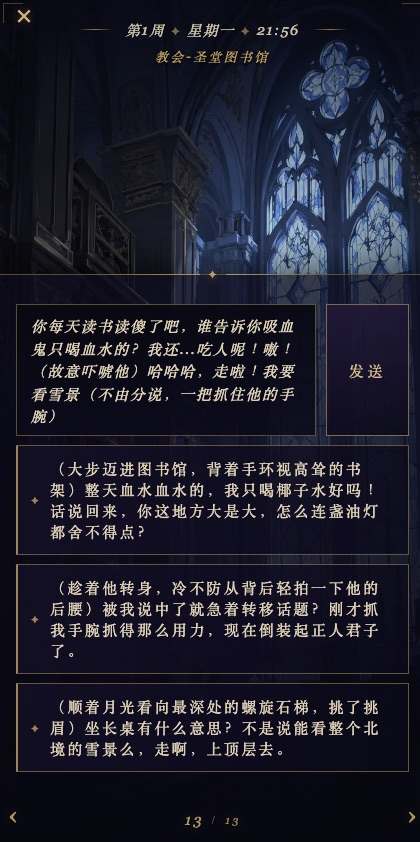
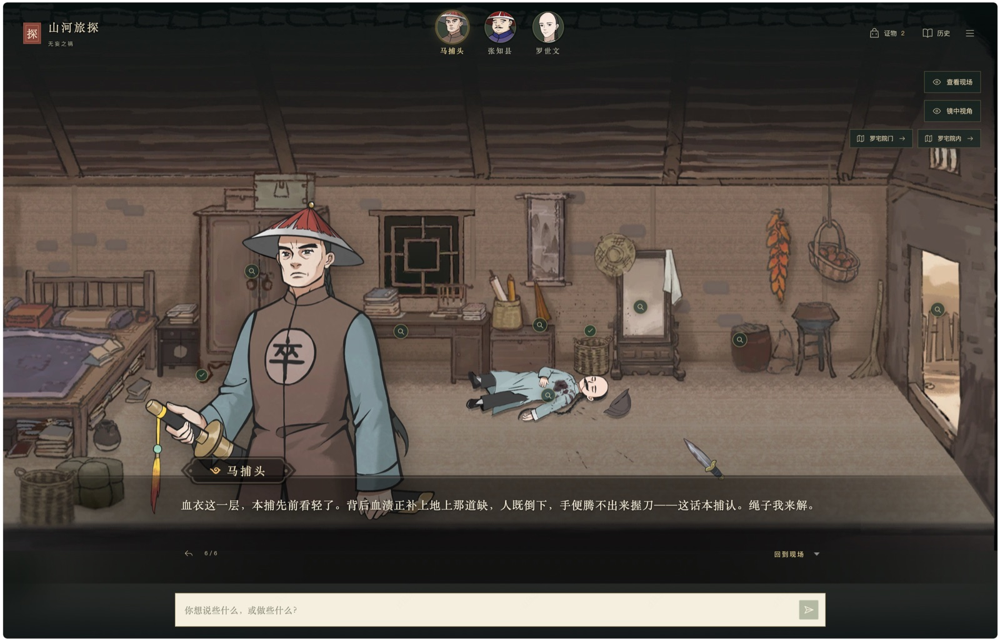
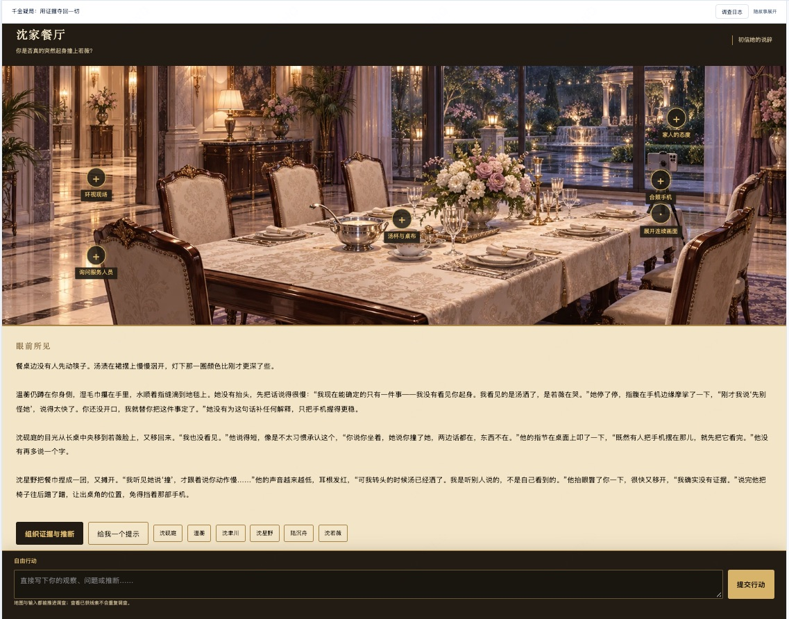
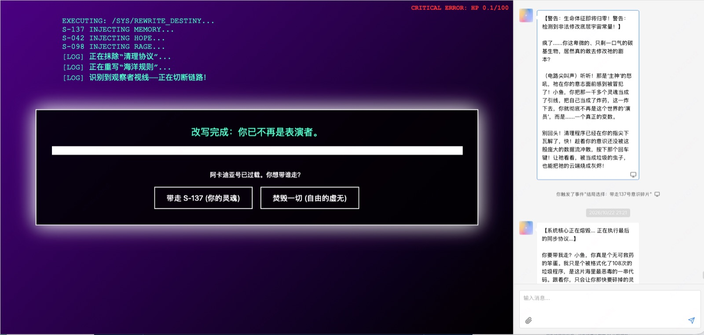

# 关于文游的一些思考

---

## 一、背景

7 月我们做了两个 demo：偏恋爱陪伴的《油画老师》和偏剧情的《别墅第七号》。之后团队围绕这两个方向又做了不少尝试。最近一次集中讨论，大家倾向于把重心放在**文游**上——一种以互动解谜为核心、由 AI 驱动的文字冒险。

---

## 二、为什么是文游

**1. 我们自己的 demo 给了信号**

《别墅第七号》被改成文游之后，体验明显更好了。地下室那扇门开不开、今天开还是明天开、要不要先去套女主人的话……这些“当下要做的决定”本身就是玩法，玩家能感觉到自己的选择有分量。相比之下，恋爱向的内容我们试了不少，效果不太稳定。

**2. AI 补上了文游最贵的那一块**

传统文字冒险的分支要一条条手写，所以通常只能给两三个选项。有了 AI，“选项之外的行动”也能被接住：玩家可以问一个设计者没想到的问题，做一件剧本里没写过的事，故事依然能回应。这是只有 AI 才能做的玩法，而不只是在老品类上加一层 AI。

**3. 和团队的能力更匹配**

恋爱向内容很依赖细腻的情感写作；文游更依赖结构——真相怎么藏，线索怎么摆，节奏怎么控。后者和团队擅长的机制设计更接近。

**4. 赛道相对没那么拥挤**

情感陪伴类产品在国内外都已经很多了。AI 加互动解谜还比较早期，想象空间可能更大一些。

**5. 和之前的探索不冲突**

一个好的文游故事往往有多个结局。通关之后，玩家依然可以和故事里的角色继续聊下去。之前在陪伴方向上的积累（角色设定、记忆、长期对话）在这里还用得上。

---

## 三、看到的几种做法

**猫又 ·《凛约》**

平台型产品猫又上的一个作品，偏视觉小说：立绘、场景、时间地点，翻页式叙事。比较有意思的是它的选项：每个选项都是一整段带动作的台词，玩家可以直接改完再发。选项更像是“帮你起了个头”。

&nbsp;&nbsp;

**山河旅探（团队 demo）**

开场交代案情之后，玩家就进入了现场：点场景里的可疑之处收集证物，选择和捕头、知县或相关人对话，从对话里套出信息。收集到的证物可以“带入输入”，拿着证据去追问。在这里，调查就是对话本身。

**千金疑局（团队 demo）**

场景图上标着可以调查的地方，下方是“眼前所见”的叙述。关键的一步是“组织证据与推断”：玩家自己挑证据、写下推断，提交后再由在场的人核验；卡住时可以要一个提示。

**祖宗来电（团队 demo）**

左边是剧情主线的节点目录，顶部是当前节点和几个状态值。每一轮给三个选项，分成“动作 / 内心 / 对话”三类，也可以随时自由说。玩家自由发挥时，主线会“原地等你”，并有剧情指路提示怎么回到主线。

**海洋求生（团队 demo）**

画面风格完全不同：赛博终端式的界面、生命值、终局抉择。每个剧本都可以有自己的界面和画风。

---

## 四、目前在想的产品形态

综合这些尝试，目前大致是下面这个样子，还在验证中。

**一局一个完整故事**

20 到 40 分钟，有开场、有调查、有高潮、有多个结局，碎片时间也能完整玩完一局。

**玩家身份由剧本决定**

可以是“你自己”，也可以带着一个人设进入故事，比如侦探、继承人、新来的学生。

**开场之后，靠对话推进**

开场交代完背景，就把玩家放进场景里：和角色聊天、套话、追问，在对话中拿到线索。这是和传统文游最不一样的地方。

**三个选项，加上随时自由输入**

每一轮给三个建议选项，降低上手门槛；同时随时可以自己写。选项尽量写成带动作的一句话，像一份可以直接用的草稿。

**自由发挥时，主线在原地等你**

玩家可以离开主线去闲逛、去试探，主线不会丢；需要时有提示把人引回来。这样既有自由度，故事也不会散掉。

**规则和状态交给程序，演绎交给 AI**

线索、证物、进度和关键数值由程序记录和判定，AI 负责把场景、人物和对白演活。真相是固定的，不会被 AI 随口改掉。

**推理让玩家自己来做**

到了关键节点，由玩家组织证据、给出推断，系统来核验。解开谜题的成就感是玩家自己的。

**每个剧本有自己的画面**

场景图和界面风格都按故事来定：悬疑的、古风的、赛博的，各不相同。

**结局之后，角色还在**

通关后可以继续和角色聊，不同的结局会带出不同的关系。

**先从单人开始**

几个人一起“跑团”非常有意思，但也复杂得多，先把单人体验做好。

**平台和自产剧本同时在试**

一部分同学在把已有的故事交给 AI，看能不能跑通；一部分同学在原创写作。

---

## 五、一些挑战

**逻辑推理是最大的难点**

AI 能把故事讲起来，但解谜需要严密的逻辑：线索之间要自洽，真相不能前后矛盾，不能太早透底，也不能被玩家几句话带偏。目前的思路是把规则和状态尽量放在程序里，AI 只负责演绎，但这条路能走多远还需要更多验证。

**自由输入的边界**

玩家可能会说“我直接把门砸开”。放得太宽，谜题就被绕过去了；收得太紧，又变回了选择题。中间需要一层判断：这个动作在当前情况下能不能成立，会带来什么后果。

**节奏和卡关**

跑团好玩，很大一部分来自主持人对节奏的把控。AI 来主持时，玩家卡住了要给提示，但不能直接给答案；玩家跑偏了，要能自然地拉回来。

**剧本怎么生产**

一个能玩的文游剧本，需要拆出真相、线索、人物动机和结局条件。无论是改编已有的故事还是原创，都要先整理成这样的结构，这一步目前还比较依赖人工。如果将来开放给创作者，门槛怎么降也是个问题。

**成本**

每一轮都要生成叙事，有时还要生成画面，一局下来的模型成本不低，需要在体验和成本之间找平衡。

---

*2026/11 · Reverie 团队*
